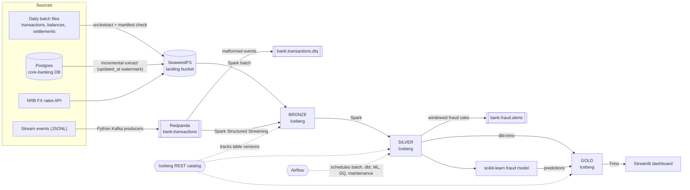

# Architecture: Real-Time Digital Banking Lakehouse

> **Living document.** Last updated: 2026-11-20 (M0, core layer).
> Update it at the end of every milestone, as part of passing that milestone.
> ✅ = built and running · ⏳ = planned

## 1. What this project does

Transactions, fraud alerts and reconciliation for a (synthetic) Nepali digital bank, with batch and streaming data in one Apache Iceberg lakehouse. Everything runs locally in Docker.

<!-- Rewrite this in your own words: 2–3 sentences you would say in an interview. -->

## 2. Data flow diagram

## 3. Components

| Component | Technology | Role in the pipeline | Profile | Port(s) | Status |
|---|---|---|---|---|---|
| Object storage | SeaweedFS (`weed mini`, S3 API, path-style) | Stores every file: landing files, Iceberg data and metadata files, streaming checkpoints | core | 8333 (S3), 23646 (admin UI) | ✅ |
| Table catalog | Iceberg REST (`apache/iceberg-rest-fixture`, SQLite on a volume) | Keeps track of each table's current metadata file. Stores no data | core | 8181 | ✅ |
| Source database | Postgres 18 | Plays the bank's core-banking system (customers, accounts). Data flows **out** of it | core | 5432 | ✅ |
| Processing | Spark (local mode) + Iceberg runtime | Batch and streaming jobs: bronze and silver | spark | — | ⏳ |
| Message broker | Redpanda (Kafka API) | Carries transaction events, DLQ and fraud alerts | streaming | — | ⏳ |
| Transformations | dbt-trino | Gold star schema, KPIs, reconciliation marts, tests | serving | — | ⏳ |
| Query engine | Trino | SQL over Iceberg for dbt and the dashboard | serving | — | ⏳ |
| Dashboard | Streamlit | KPIs, alerts, model predictions | serving | — | ⏳ |
| Orchestration | Airflow (standalone) | Schedules batch, dbt, ML, data quality, Iceberg maintenance | orchestration | — | ⏳ |

## 4. Storage layout

**Buckets:** `landing` (raw files as received) · `warehouse` (Iceberg tables) · `checkpoints` (streaming state)

| Layer | Built with | Contents | Rule |
|---|---|---|---|
| Bronze | Spark | Raw data, appended, plus ingestion metadata (source, ingested_at, file or Kafka partition + offset) | Never modified |
| Silver | Spark | Typed, deduplicated, late data handled, SCD2 customers/accounts, reversals linked | Idempotent (MERGE) |
| Gold | dbt via Trino | Star schema, KPIs, reconciliation marts, fraud alerts, model predictions | Tested with dbt tests |

## 5. Data sources

| Source | Type | Lands in |
|---|---|---|
| Daily transaction, balance and settlement files | Batch files | landing → bronze |
| Customers and accounts (Postgres) | Incremental database extract | landing → bronze → SCD2 dims |
| Reference data (branches, merchant categories, transaction types) | Static files | landing → static dims |
| Source manifest | SHA-256 checksums | Integrity check on ingest |
| Transaction events | Stream (Redpanda) | bronze stream table |
| Nepal Rastra Bank FX rates | External API | NPR → GBP/USD conversion in gold |

## 6. Key design decisions

| # | Decision | Record |
|---|---|---|
| 0001 | SeaweedFS for object storage instead of MinIO | [decisions/0001-object-storage-seaweedfs.md](decisions/0001-object-storage-seaweedfs.md) |
| — | Develop in WSL2 Ubuntu (`~/projects`), not on a Windows drive | to write |
| — | WSL capped at 16 GB / 12 CPUs; memory limit on every container; start only the profiles a milestone needs | to write |
| — | Iceberg REST catalog persisted to SQLite on a named volume | to write |
| — | `updated_at` set by a Postgres trigger, not by application code | to write |

## 7. Resource budget

| Profile | Services | Approx. RAM | Status |
|---|---|---|---|
| core | SeaweedFS, Iceberg REST, Postgres | ~1.8 GB | ✅ |
| spark | Spark (local mode) | ~3 GB | ⏳ |
| streaming | Redpanda + console | ~0.8 GB | ⏳ |
| serving | Trino + Streamlit | ~2.5 GB | ⏳ |
| orchestration | Airflow standalone | ~2 GB | ⏳ |

How to run the stack and fix common problems: see [runbook.md](runbook.md).